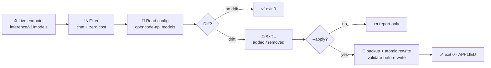

# 🧰 Check OpenCode Free Models

[](https://github.com/mahirfatih/check-opencode-free-models/actions/workflows/ci.yml)


[](https://pypi.org/project/check-opencode-free-models/)


🌐 **English** · [Türkçe](./README.tr.md)

**check-opencode-free-models** is a tiny, dependency-free CLI that keeps the
free **chat** models published by the OpenCode Console in sync with
`~/.config/opencode/opencode.jsonc`.

> ⚡ **In one line:** fetch → filter free chat models → diff against the config →
> optionally rewrite the block with a timestamped backup and an **atomic** write.
> Nothing else is read or written.

---

## 📖 Overview

| Source | Reference |
| :--- | :--- |
| 📚 Free models documentation | <https://opencode.ai/docs/models/#free-models> |
| 🖥️ OpenCode Desktop | <https://opencode.ai/desktop> |
| 🌐 Live endpoint (no auth) | `https://opencode.ai/inference/v1/models` |

Filter rule: `type == "chat"` **and** `cost.text.input.price == 0` **and**
`cost.text.output.price == 0`. Decision models (`type: decision`, e.g. Jev) are
never written to the `opencode-api` block; skipped free non-chat models are
reported as a warning.



---

## ✨ Features

- 🔄 **Drift detection** — lists models to `add` / `remove`, exits `0` in sync and `1` on drift.
- 🛡️ **Safe apply** — timestamped backup, JSONC-aware validation **before** writing, and an atomic `os.replace` write.
- ♚ **Idempotent** — re-running `--apply` reports no drift.
- 🎛️ **Configurable** — `--config PATH` or `OPENCODE_CONFIG_PATH`; endpoint via `OPENCODE_MODELS_URL`.
- 🧪 **44 tests, stdlib only** — smoke / sanity / unit / regression / integration / e2e / UI, plus GitHub Actions CI.
- 🌐 **English + Türkçe** docs.

---

## 🚀 Quick start

### 1. Requirements

| Requirement | Notes |
| :--- | :--- |
| Python | 3.10+ (standard library only — no `pip install` needed) |
| Target | OpenCode Desktop's own `~/.config/opencode/opencode.jsonc` |

### 2. Run

```bash
python3 check-opencode-free-models.py                  # drift report
python3 check-opencode-free-models.py --apply          # update, with backup
python3 check-opencode-free-models.py --dry-run        # report only, never write
python3 check-opencode-free-models.py --config PATH    # use another config file
python3 check-opencode-free-models.py --version        # print version and exit
```

### 3. Flags

| Flag | Effect |
| :--- | :--- |
| *(none)* | Drift report; exit `0` in sync, `1` on drift. No writes. |
| `--apply` | Rewrite the `models` block after backup + validation. |
| `--dry-run` | Force report-only (overrides `--apply`). |
| `--config PATH` | Override `OPENCODE_CONFIG_PATH` / default config path. |
| `--version` | Print version, exit immediately. |

### 4. Example output

```text
live free chat models: 10
config models            : 10
to add     : -
to remove  : -
RESULT: in sync, no drift.
```

---

## 🧠 How it works

1. **🔍 Fetch** — `fetch_free_ids()` reads the endpoint (3 retries on transient
   failures). Only zero-cost chat models are kept.
2. **📄 Read** — `read_config_models()` parses the `id → name` map from
   `provider.opencode-api.models`.
3. **🧮 Diff** — compare live IDs with config IDs → `added` / `removed`.
4. **🛡️ Apply** (only with `--apply`):
   - timestamped backup `opencode.jsonc.bak-YYYY-MM-DD-HH_MM_SS` (`shutil.copy2`);
   - `build_block()` joins entries with commas (no trailing comma);
   - **validate-before-write** — the rewritten JSONC is normalized and parsed
     *before* the file is touched;
   - **atomic write** — temp file in the same directory + `os.replace`.

Existing `name` values are preserved on update. Idempotent: a second `--apply`
reports no drift.

---

## 🗂️ What gets pulled from where

| Source | What | Target |
| :--- | :--- | :--- |
| 🌐 Live endpoint (no auth) | Free chat models (`type == "chat"`, zero input/output price) — `id` + `name` | `~/.config/opencode/opencode.jsonc` → `provider.opencode-api.models` |
| 📄 Existing config | Already-stored `name` values | merged into the rewritten block |
| 💾 `--apply` | Rewrites the block; timestamped backup | same file |

The example config `opencode-free-models.config.example.jsonc` shows the shape
of the `opencode-api` block (redacted, no secrets).

---

## 🤖 Current free chat models

As of **2026-11-24** the Console lists **10** free chat models (run the script
to refresh — the live endpoint is the source of truth):

- `beam-free` — Beam Free
- `big-pickle` — Big Pickle
- `deepseek-v4.1-flash-free` — DeepSeek V4.1 Flash Free
- `flint-40b-free` — Flint 40B Free
- `hy4-flash-free` — Hy4 flash Free
- `iceman-free` — Iceman Free
- `mimo-v2.6-flash-free` — MiMo-V2.6-Flash Free
- `nemotron-3.5-lightning-free` — Nemotron 3.5 Lightning Free
- `nemotron-3.5-super-vl-free` — Nemotron 3.5 Super VL Free
- `tidepool-alpha-free` — Tidepool Alpha Free

---

## ⏰ Desktop & crontab

The tool targets **OpenCode Desktop's** own `~/.config/opencode/opencode.jsonc`
— it never touches any other config file. Apply updates with `--apply`, or run
a daily drift check from crontab:

```cron
0 6 * * * /path/to/check-opencode-free-models/check-opencode-free-models.py
```

Exit codes: `1` on drift (`RESULT: drift found. Update with --apply.`),
`0` when in sync (`RESULT: in sync, no drift.`).

---

## 📂 Project structure

```text
check-opencode-free-models/
├── check-opencode-free-models.py         # working script (fetch · drift · apply · backup)
├── opencode-free-models.config.example.jsonc
├── README.md · README.tr.md              # this tour / Türkçe tur
├── CHANGELOG.md · SECURITY.md · CONTRIBUTING.md · LICENSE
├── pyproject.toml
├── .github/workflows/ci.yml              # py_compile + unittest
├── test/                                 # 7 suites + README.md + run_all_tests.sh
│   ├── test_smoke.py · test_sanity.py · test_unit.py
│   ├── test_regression.py · test_integration.py
│   └── test_e2e.py · test_automated_ui.py
└── docs/
    ├── README.md
    └── testing/TESTING.md
```

---

## 🧪 Testing & CI

Standard-library-only automated suites under [`test/`](./test/):

```bash
python3 -m unittest discover -s test -p "test_*.py" -v
```

| Suite | File | Focus |
| :--- | :--- | :--- |
| 💨 Smoke | [`test_smoke.py`](./test/test_smoke.py) | Compile, module load, JSONC basics. |
| ✅ Sanity | [`test_sanity.py`](./test/test_sanity.py) | Constants, example config, generated block. |
| 🔬 Unit | [`test_unit.py`](./test/test_unit.py) | Pure functions with mocks; CLI flags. |
| 🩹 Regression | [`test_regression.py`](./test/test_regression.py) | JSONC bug + apply idempotency. |
| 🔗 Integration | [`test_integration.py`](./test/test_integration.py) | Local HTTP server + full pipeline. |
| 🎯 E2E | [`test_e2e.py`](./test/test_e2e.py) | Real CLI subprocess, isolated `HOME`. |
| 🖥️ UI | [`test_automated_ui.py`](./test/test_automated_ui.py) | Output, messages, exit codes. |

Before a change: `python3 -m py_compile check-opencode-free-models.py` and the
full suite above. CI runs both on every push and pull request.

---

## 📚 Documentation

- [`README.tr.md`](./README.tr.md) — Türkçe tur.
- [`docs/README.md`](./docs/README.md) — documentation map.
- [`docs/testing/TESTING.md`](./docs/testing/TESTING.md) — testing guide.
- [`test/README.md`](./test/README.md) — suite overview.
- [`CHANGELOG.md`](./CHANGELOG.md) · [`SECURITY.md`](./SECURITY.md) · [`CONTRIBUTING.md`](./CONTRIBUTING.md).

---

## 🔮 Roadmap

- **✅ Done:** atomic write, robust `type` filter, decision-model WARN, env
  overrides, `--dry-run`, `--config` / `--version`, network retries, CI.
- **Remaining:** `recommended_api` routing — the systemone endpoint currently returns 404.

---

## 📄 License

MIT — see [`LICENSE`](./LICENSE).
