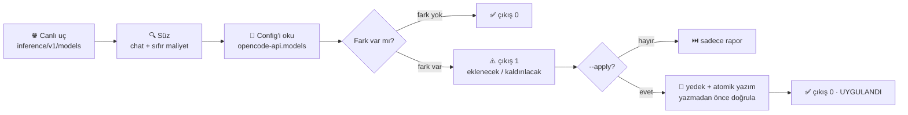

# 🧰 Check OpenCode Free Models

[](https://github.com/mahirfatih/check-opencode-free-models/actions/workflows/ci.yml)


[](https://pypi.org/project/check-opencode-free-models/)


🌐 [English](./README.md) · **Türkçe**

**check-opencode-free-models**, OpenCode Console'un yayınladığı ücretsiz
**chat** modellerini `~/.config/opencode/opencode.jsonc` ile senkronize eden,
bağımlılıksız küçük bir CLI aracı.

> ⚡ **Tek satırda:** çek → ücretsiz chat modellerini süz → config ile karşılaştır
> → istersen zaman damgalı yedek + **atomik** yazımla bloğu güncelle.
> Başka hiçbir şey okunmaz veya yazılmaz.

---

## 📖 Genel bakış

| Kaynak | Referans |
| :--- | :--- |
| 📚 Ücretsiz modeller belgesi | <https://opencode.ai/docs/models/#free-models> |
| 🖥️ OpenCode Desktop | <https://opencode.ai/desktop> |
| 🌐 Canlı endpoint (auth yok) | `https://opencode.ai/inference/v1/models` |

Filtre kuralı: `type == "chat"` **ve** `cost.text.input.price == 0` **ve**
`cost.text.output.price == 0`. Karar modelleri (`type: decision`, örn. Jev)
`opencode-api` bloğuna asla yazılmaz; atlanan ücretsiz chat-olmayan modeller
uyarı olarak raporlanır.



---

## ✨ Özellikler

- 🔄 **Drift tespiti** — eklenecek / kaldırılacak modelleri listeler; güncelse `0`, fark varsa `1` döner.
- 🛡️ **Güvenli apply** — zaman damgalı yedek, yazmadan **önce** JSONC doğrulaması ve atomik `os.replace` yazımı.
- ♚ **İdempotent** — `--apply` tekrar çalıştırılınca drift görünmez.
- 🎛️ **Yapılandırılabilir** — `--config PATH` veya `OPENCODE_CONFIG_PATH`; endpoint `OPENCODE_MODELS_URL` ile değiştirilebilir.
- 🧪 **44 test, sadece stdlib** — smoke / sanity / unit / regression / integration / e2e / UI + GitHub Actions CI.
- 🌐 **İngilizce + Türkçe** doküman.

---

## 🚀 Hızlı başlangıç

### 1. Gereksinimler

| Gereksinim | Not |
| :--- | :--- |
| Python | 3.10+ (yalnızca standart kütüphane — `pip install` gerekmez) |
| Hedef | OpenCode Desktop'ın kendi `~/.config/opencode/opencode.jsonc` dosyası |

### 2. Çalıştır

```bash
python3 check-opencode-free-models.py                  # drift raporu
python3 check-opencode-free-models.py --apply          # yedeği alarak güncelle
python3 check-opencode-free-models.py --dry-run        # sadece rapor, asla yazmaz
python3 check-opencode-free-models.py --config PATH    # farklı bir config dosyası
python3 check-opencode-free-models.py --version        # sürümü yazdır ve çık
```

### 3. Parametreler

| Parametre | Etkisi |
| :--- | :--- |
| *(yok)* | Drift raporu; güncelse `0`, fark varsa `1`. Yazma yapmaz. |
| `--apply` | Yedek + doğrulama sonrası `models` bloğunu yeniden yazar. |
| `--dry-run` | Sadece rapor modunu zorlar (`--apply`'i geçersiz kılar). |
| `--config PATH` | `OPENCODE_CONFIG_PATH` / varsayılan config yolunu override eder. |
| `--version` | Sürümü yazdırır ve hemen çıkar. |

### 4. Örnek çıktı

```text
live free chat models: 10
config models            : 10
to add     : -
to remove  : -
RESULT: in sync, no drift.
```

---

## 🧠 Nasıl çalışır

1. **🔍 Çek** — `fetch_free_ids()` endpoint'i okur (geçici hatalarda 3 deneme).
   Yalnızca sıfır maliyetli chat modelleri tutulur.
2. **📄 Oku** — `read_config_models()`, `provider.opencode-api.models` içindeki
   `id → name` eşlemesini ayrıştırır.
3. **🧮 Karşılaştır** — canlı ID'ler ile config ID'leri farkı: `eklenecek` /
   `kaldırılacak`.
4. **🛡️ Apply** (yalnızca `--apply` ile):
   - zaman damgalı yedek `opencode.jsonc.bak-YYYY-MM-DD-HH_MM_SS` (`shutil.copy2`);
   - `build_block()` satırları virgülle birleştirir (sonunda virgül yok);
   - **yazmadan önce doğrula** — yeniden yazılan JSONC normalize edilip
     dosyaya dokunulmadan önce ayrıştırılır;
   - **atomik yazım** — aynı dizinde geçici dosya + `os.replace`.

Güncellemede mevcut `name` değerleri korunur. İdempotent: ikinci `--apply`
fark raporlamaz.

---

## 🗂️ Neler nereden çekilir

| Kaynak | Ne | Hedef |
| :--- | :--- | :--- |
| 🌐 Canlı uç (auth yok) | Ücretsiz chat modelleri (`type == "chat"`, giriş/çıkış fiyatı 0) — `id` + `name` | `~/.config/opencode/opencode.jsonc` → `provider.opencode-api.models` |
| 📄 Mevcut config | Kayıtlı `name` değerleri | yeniden yazılan bloğa birleştirilir |
| 💾 `--apply` | Bloğu yeniden yazar; zaman damgalı yedek | aynı dosya |

`opencode-free-models.config.example.jsonc` örnek dosyası `opencode-api`
bloğunun şeklini gösterir (redacted, secret yok).

---

## 🤖 Güncel ücretsiz chat modelleri

**2026-11-24** itibarıyla Console **10** ücretsiz chat modeli listeliyor
(kaynak her zaman canlı uçtur; yenilemek için script'i çalıştır):

- `beam-free` — Beam Free
- `big-pickle` — Big Pickle
- `deepseek-v4.1-flash-free` — DeepSeek V4.1 Flash Free
- `flint-40b-free` — Flint 40B Free
- `hy4-flash-free` — Hy4 flash Free
- `iceman-free` — Iceman Free
- `mimo-v2.6-flash-free` — MiMo-V2.6-Flash Free
- `nemotron-3.5-lightning-free` — Nemotron 3.5 Lightning Free
- `nemotron-3.5-super-vl-free` — Nemotron 3.5 Super VL Free
- `tidepool-alpha-free` — Tidepool Alpha Free

---

## ⏰ Desktop ve crontab

Araç **OpenCode Desktop'ın** kendi `~/.config/opencode/opencode.jsonc`
yapılandırmasını hedefler — başka bir config dosyasına dokunmaz. `--apply` ile
otomatik güncelleyebilir veya günlük drift kontrolü için crontab ekleyebilirsin:

```cron
0 6 * * * /path/to/check-opencode-free-models/check-opencode-free-models.py
```

Çıkış kodları: drift varsa `1` (`RESULT: drift found. Update with --apply.`),
güncelse `0` (`RESULT: in sync, no drift.`).

---

## 📂 Proje yapısı

```text
check-opencode-free-models/
├── check-opencode-free-models.py         # çalışan script (çek · drift · apply · yedek)
├── opencode-free-models.config.example.jsonc
├── README.md · README.tr.md              # İngilizce tur / bu tur
├── CHANGELOG.md · SECURITY.md · CONTRIBUTING.md · LICENSE
├── pyproject.toml
├── .github/workflows/ci.yml              # py_compile + stdlib test runner
├── test/                                 # 7 suite + runner'lar + README.md
│   ├── run-tests.py                      # importlib tabanlı stdlib runner
│   ├── run-all-tests.sh                  # kabuk sarmalayıcı
│   ├── test-smoke.py · test-sanity.py · test-unit.py
│   ├── test-regression.py · test-integration.py
│   └── test-e2e.py · test-automated-ui.py
└── docs/
    ├── README.md
    └── testing/TESTING.md
```

---

## 🧪 Test ve CI

Sadece standart kütüphane kullanan otomatik suite'ler: [`test/`](./test/)

```bash
python3 test/run-tests.py               # tüm suite'ler
./test/run-all-tests.sh unit            # tek suite (kabuk sarmalayıcı)
```

`unittest discover` tireli modül adlarını import edemediği için runner her
`test-*.py` dosyasını `importlib` ile yolundan yükler.

| Suite | Dosya | Odak |
| :--- | :--- | :--- |
| 💨 Smoke | [`test-smoke.py`](./test/test-smoke.py) | Derleme, modül yükleme, JSONC temelleri. |
| ✅ Sanity | [`test-sanity.py`](./test/test-sanity.py) | Sabitler, örnek config, üretilen blok. |
| 🔬 Unit | [`test-unit.py`](./test/test-unit.py) | Mock'larla saf fonksiyonlar; CLI parametreleri. |
| 🩹 Regression | [`test-regression.py`](./test/test-regression.py) | JSONC hatası + apply idempotency. |
| 🔗 Integration | [`test-integration.py`](./test/test-integration.py) | Yerel HTTP sunucu + tam akış. |
| 🎯 E2E | [`test-e2e.py`](./test/test-e2e.py) | Gerçek CLI subprocess, izole `HOME`. |
| 🖥️ UI | [`test-automated-ui.py`](./test/test-automated-ui.py) | Çıktı, mesajlar, çıkış kodları. |

Değişiklik öncesi: `python3 -m py_compile check-opencode-free-models.py` ve
yukarıdaki tam suite. CI her push ve PR'da ikisini de çalıştırır.

---

## 📚 Dokümanlar

- [`README.md`](./README.md) — İngilizce tur.
- [`docs/README.md`](./docs/README.md) — doküman haritası.
- [`docs/testing/TESTING.md`](./docs/testing/TESTING.md) — test rehberi.
- [`test/README.md`](./test/README.md) — suite özeti.
- [`CHANGELOG.md`](./CHANGELOG.md) · [`SECURITY.md`](./SECURITY.md) · [`CONTRIBUTING.md`](./CONTRIBUTING.md).

---

## 🔮 Yol haritası

- **✅ Tamamlandı:** atomik yazım, robust `type` filtresi, decision-model WARN,
  env override'ları, `--dry-run`, `--config` / `--version`, ağ retry'leri, CI.
- **Kalan:** `recommended_api` routing — systemone endpoint şu an 404 dönüyor.

---

## 📄 Lisans

MIT — [`LICENSE`](./LICENSE) dosyasına bakın.
